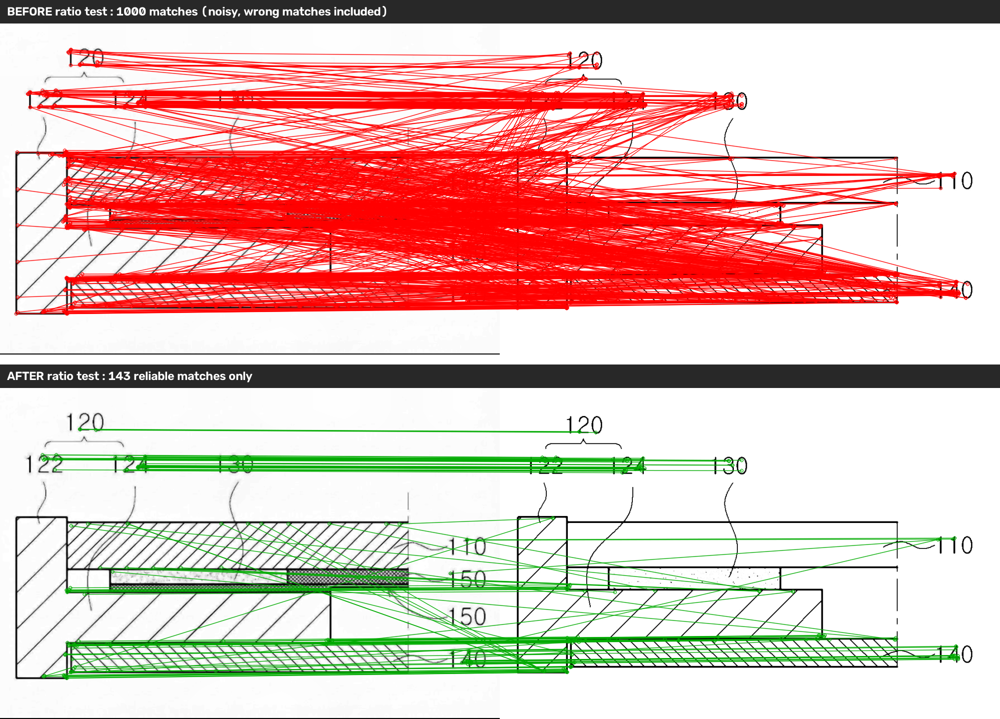
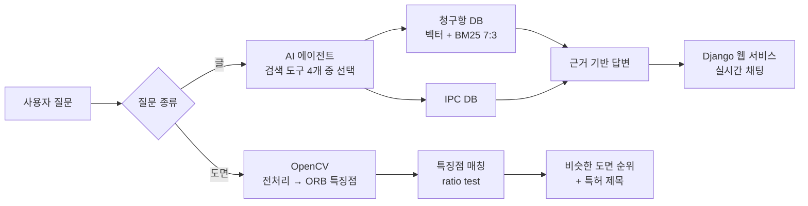

# 컴퓨터 비전 특허 검색 AI 챗봇 + 도면 유사도 검색

자연어로 질문하면 **비슷한 특허와 분류 코드(IPC)를 찾아 근거와 함께 답하는** 챗봇입니다.
여기에 개인적으로 **특허 도면 이미지로 비슷한 도면을 찾는 OpenCV 검색**을 더했습니다.

- **기간**: 2025.11 ~ 2025.12 (팀 프로젝트: 1단계 검색 엔진 → 2단계 웹 서비스) → 이후 개인 복기·업그레이드
- **형태**: SK Networks 부트캠프 팀 프로젝트 2건 (5인, 같은 팀이 이어서 진행)
- **원본 팀 레포**
  - 1단계 검색 엔진: [SKN19-3rd-2Team](https://github.com/SKNETWORKS-FAMILY-AICAMP/SKN19-3rd-2Team)
  - 2단계 웹 서비스: [SKN19-4th-2Team](https://github.com/SKNETWORKS-FAMILY-AICAMP/SKN19-4th-2Team)

<!--
[TODO] 최상단 데모 자리
 - 웹 서비스 채팅 화면 캡처
 - 예: 
-->

---

## 한눈에 보기

| 항목 | 내용 |
|------|------|
| 무엇을 | 글이나 도면으로 비슷한 특허를 찾고, 근거를 들어 답하기 |
| 데이터 | 공개 특허 28,079건 (청구항 589,049개), IPC 코드 약 7만 건, 도면 이미지 50장 |
| 흐름 | 질문 → AI가 알맞은 검색 도구 선택 → DB 검색 → 근거 기반 답변 / 도면 → OpenCV 비교 → 비슷한 도면 순위 |
| 성과 | 도면 검색 원본 1위 찾기 **98~100%** (50장, 변형 6가지) / 텍스트 검색 Hit@5 **96.7%** (질문 30개) |
| 내 역할 | 검색 평가 기준, 웹 프론트엔드 전반·회원 기능 (팀) / OpenCV 도면 검색, 정량 평가, 저장소 정리 (개인) |

---

## 내가 한 일

| 구분 | 담당 | 한 줄 요약 |
|------|------|-----------|
| 팀 | 검색 평가 기준 설계 | "같은 IPC 코드를 공유하면 비슷한 특허"를 기준으로 검색 결과를 숫자로 비교할 수 있게 만듦 |
| 팀 | 웹 프론트엔드 전반 | 화면 디자인부터 실시간 채팅 화면까지 HTML·CSS·JavaScript로 구현 |
| 팀 | 회원 기능 | 회원가입·로그인·마이페이지·탈퇴, 비회원 채팅과 가입 시 대화 이관 |
| 개인 | OpenCV 도면 검색 | 도면 한 장을 넣으면 특징점을 비교해 비슷한 도면을 순서대로 보여주는 기능 |
| 개인 | 정량 평가 | 도면 검색을 50장·변형 6가지로 평가하고, 팀이 넣은 Z-score를 질문 30개로 다시 측정 |
| 개인 | 저장소 정리 | 팀 레포 2개를 하나로 합치고, 비밀 값은 환경변수로 빼고, 대용량 DB는 깃에서 제외 |

---

## 1. 특허 검색 엔진 (팀)

### 무엇을 하나

사용자가 질문하면 AI가 질문 종류를 보고 **4개 검색 도구 중 알맞은 것을 골라** 씁니다.

| 도구 | 하는 일 |
|------|---------|
| 비슷한 특허 찾기 | 기술 설명 → 의미가 비슷한 청구항 검색 → 특허 단위로 다시 정렬 |
| 출원번호로 조회 | 특허 번호 → 제목·청구항·IPC 조회 |
| IPC 코드 추천 | 기술 설명 → 어울리는 분류 코드 후보 |
| IPC 코드 설명 | 분류 코드 → 뜻과 상하위 계층 |

### 검색을 정확하게 만든 방법

- **두 가지 검색을 섞음**: 의미로 찾기(벡터)와 단어로 찾기(BM25)를 **7 : 3**으로 합침
- **특허 단위로 다시 정렬**: 청구항 하나만 우연히 비슷한 특허가 위로 오지 않게, 상위 청구항 평균·최고 점수·찾은 청구항 수를 함께 반영
- **IPC 검색 다듬기**: 거리가 먼 결과(1.4 이상)는 버리고, 부모가 같은 형제 코드는 가장 가까운 것만 남김
- **평가 기준**: 정답 데이터가 없어서 "같은 IPC 코드를 공유하면 비슷한 특허"로 가정하고, 검색된 특허가 정답 IPC를 얼마나 포함하는지 셈

---

## 2. 여러 질문을 합칠 때의 편향 (팀 → 개인 재측정)

### 왜 문제였나

한 아이디어를 "곡률이 변하는 디스플레이", "사용자 거리 감지"처럼 여러 질문으로 나눠 검색하면, 결과를 하나로 합쳐야 합니다.
그런데 질문마다 거리 숫자의 범위가 달라서 **흔한 주제의 질문이 상위 200개를 거의 다 차지**하고, 다른 질문의 특허는 밀려나는 문제가 있었습니다.

### 어떻게 했나

질문마다 거리의 평균과 퍼진 정도로 **Z-score**를 계산해, 같은 기준으로 맞춘 뒤 합쳤습니다.
팀 프로젝트 당시에는 상위 200개 청구항 중 **약 25~50%가 다른 청구항으로 바뀌는 것**(결과가 다양해짐)을 확인했습니다.

### 개인 재측정: 정답을 더 잘 찾게 됐나?

"결과가 달라졌다"와 "정답을 더 잘 찾는다"는 다른 이야기라서, 같은 조건으로 다시 측정했습니다.

| 항목 | 내용 |
|------|------|
| 질문 | 특허 30건의 초록에서 문장 3개씩을 뽑아 질문 3개로 사용 (무작위, 시드 고정) |
| 정답 | 질문을 만든 그 특허 (초록이 똑같은 특허가 있으면 함께 정답 처리) |
| 비교 | Before: 거리 그대로 합침 / After: Z-score로 합침 (나머지 조건은 모두 같음) |

| 평가 지표 | Before | After |
|-----------|:------:|:-----:|
| Hit@5 | 96.7% | 96.7% |
| Hit@10 | 96.7% | 96.7% |

*Hit@k: 상위 k개 특허 안에 정답이 있는 질문의 비율*

- **이 측정에서는 차이가 없었습니다.** 순위가 바뀐 질문도 30개 중 3개뿐입니다.
- 질문 3개를 같은 초록에서 뽑아서 거리 범위가 서로 비슷했고, Z-score가 효과를 낼 상황(주제가 크게 다른 질문끼리 합치기)을 만들지 못한 것으로 보입니다.
- 그래서 "성능이 올랐다"가 아니라 **"편향을 막는 장치이며, 이 조건에서는 성능 차이가 없었다"**고 정리했습니다.

---

## 3. 웹 서비스 (팀, 프론트엔드·회원 기능 담당)

웹 화면 전체를 디자인하고 구현했고, 회원 기능도 맡았습니다.

- 답변이 **한 글자씩 실시간으로** 나오는 채팅 화면, AI가 어떤 도구를 쓰는 중인지 보여주는 표시
- 대화방 목록, 제목 수정, 드래그로 순서 바꾸기, 메시지 삭제
- 회원가입·로그인·마이페이지·회원 탈퇴, 로그인 없이도 쓰는 비회원 채팅
- 비회원이 가입하면 그동안의 대화를 새 계정으로 옮김

---

## 4. OpenCV 도면 검색 (개인 업그레이드)

### 왜 만들었나

특허 도면은 글로 설명하기 어렵습니다. "둥근 렌즈가 여러 겹 쌓인 구조"를 말로 쓰기보다, **도면 한 장을 그대로 넣어 비슷한 걸 찾는 편이 빠릅니다.**
딥러닝 없이 **OpenCV로 직접** 만들었습니다.

### 어떻게 비교하나

픽셀을 그대로 겹쳐 보는 방식이 아니라, 도면의 **특징점**(모서리·꺾이는 지점)을 뽑아 서로 짝지어지는 개수로 비교합니다.

| 단계 | 하는 일 |
|------|---------|
| ① 전처리 | 흑백 변환 → 점·얼룩 제거 → 흐린 선 또렷하게 → 긴 변을 1,000px로 맞춤 |
| ② 특징점 추출 | ORB로 도면 1장당 최대 1,000개의 특징점과 그 특징을 나타내는 숫자를 뽑음 |
| ③ 매칭 | 두 도면의 특징점을 짝지어 보고, 1등 후보가 2등보다 확실히 가까울 때만 인정 (Lowe's ratio test) |
| ④ 순위 | 확실한 짝의 비율로 점수를 내 높은 순으로 정렬 |

```
유사도 = 확실한 짝의 수 ÷ min(넣은 도면 특징점 수, 비교 도면 특징점 수)
```

- 분모를 특징점이 **적은 쪽**으로 해서, 단순한 도면도 불리하지 않게 했습니다.
- 파일 이름을 **특허 출원번호**로 두어, 결과에 바로 특허 제목을 붙입니다.



*위: 걸러내기 전 1,000쌍 (엉뚱한 짝이 섞여 선이 뒤엉킴) / 아래: 걸러낸 뒤 143쌍 (비슷한 위치끼리 연결)*

---

## 5. 도면 검색 정량 평가 (개인 업그레이드)

### 어떻게 평가했나

도면을 일부러 망가뜨려 검색에 넣고, **원래 도면이 몇 위로 나오는지** 확인했습니다.

| 항목 | 내용 |
|------|------|
| 검색 대상 | 도면 50장 (평가 도면이 그대로 검색 대상) |
| 평가 쿼리 | 50장 각각을 변형한 이미지 → 조건별 50건, 6개 조건 총 300건 |
| 변형 | 원본 / 회전 5°·15° / 50% 축소 / 노이즈 / 회전+축소+노이즈 |
| 정답 | 원본 도면. 파일이 완전히 같은 도면 1쌍(두 특허가 같은 도면 사용)은 둘 다 정답 |

### 결과

| 변형 조건 | Top-1 (정답이 1위) | Hit@5 (정답이 5위 안) |
|-----------|:------------------:|:---------------------:|
| 원본 그대로 | 100% | 100% |
| 회전 5도 | 100% | 100% |
| 회전 15도 | 100% | 100% |
| 50% 축소 | 98% | 98% |
| 노이즈 | 100% | 100% |
| 회전 + 축소 + 노이즈 | 98% | 100% |

### 잘 찾은 사례 · 못 찾은 사례

| 구분 | 내용 |
|------|------|
| 성공 | 적층 단면도를 넣었을 때 같은 구조의 특허(1020160183317)가 **0.1430**으로 1위, 2위는 0.0450 (약 3.2배 차이) |
| 실패 | 가로 244 × 세로 186px의 아주 작은 도면을 50%로 줄이자 정답이 **12위**로 밀림. 줄이면 특징점이 거의 남지 않음 |

### 한계

- 이 평가는 **같은 도면을 변형해서 다시 찾는 시험**입니다. 서로 다른 특허의 도면이 비슷한지는 이 시험으로 알 수 없습니다.
- 검색 대상이 50장이라 쉬운 조건입니다. 도면이 수천 장으로 늘면 다시 측정해야 합니다.
- **글자가 내용인 블록 다이어그램**에서 약점이 보였습니다. 메모리 시스템 다이어그램을 넣자 네모 3칸짜리 단순한 도면이 1위로 나왔습니다. (한 건 확인이라 추가 검증이 필요합니다.)

---

## 전체 구조



---

## 배운 점

- **"달라졌다"와 "좋아졌다"는 다릅니다.** Z-score로 결과는 바뀌었지만, 정답을 찾는 비율은 이 조건에서 그대로였습니다.
- **한 사례의 숫자는 시스템 성능이 아닙니다.** "1위가 7배 높다"보다 50장·300건 평가가 훨씬 믿을 만한 근거였습니다.
- **잘 안 되는 경우를 찾아야 다음이 보입니다.** 작은 도면과 글자 위주 다이어그램에서 약점을 확인했습니다.
- **좋은 모델보다 구조가 중요합니다.** 어떤 도구를 두고 어떤 형식으로 정보를 주고받을지가 답변 품질을 갈랐습니다.

---

## 사용 기술

| 분류 | 기술 |
|------|------|
| 영상처리 | Python, OpenCV, NumPy |
| AI 에이전트 / 검색 | LangChain, LangGraph, OpenAI API, ChromaDB, SentenceTransformers, BM25 |
| 웹 | Django, HTML, CSS, JavaScript, Streamlit (데모) |
| 배포 | Docker, nginx, gunicorn |

---

## 폴더 구조

```
rag_engine/
  app/                  검색 에이전트 (도구 4개, 하이브리드 검색, IPC 검색)
    build_zscore_queries.py  Z-score 평가용 질문 30개 만들기
    evaluate_zscore.py       Z-score 전후 Hit@5 · Hit@10 측정
  vision/               OpenCV 도면 검색 (개인)
    drawing_features.py      전처리 + ORB 특징점 추출
    search_drawings.py       유사 도면 검색
    evaluate_robustness.py   50장 변형 평가 (Top-1, Hit@5)
    make_match_figure.py     매칭 전후 비교 그림 생성
  streamlit/            검색 엔진 데모 화면
  db_search/ doc/ ipc/  DB 구축 · 전처리 · 검색 실험 노트북
  images/               도면 이미지 (파일명 = 출원번호, 깃에는 미포함)
web_service/            Django 웹 서비스 (회원 · 채팅 · 검색 모듈 이식)
deploy/ docker-compose.yml   nginx + gunicorn 배포 설정
```

---

## 실행 방법

```powershell
# 도면 검색 평가 (rag_engine/images 에 도면 이미지 필요)
pip install opencv-python numpy
cd rag_engine/vision
python evaluate_robustness.py          # 결과: 화면 표 + eval_results.csv
python search_drawings.py 쿼리이미지.jpg --topk 5

# Z-score 전후 측정 (청구항 벡터 DB와 원본 XML 필요)
cd rag_engine/app
python build_zscore_queries.py         # 결과: zscore_eval_queries.json
python evaluate_zscore.py              # 결과: zscore_eval_results.json
```

- 반드시 각 폴더 안에서 실행합니다. 저장소 맨 위에서 `python -m ...`으로 실행하면 모듈을 못 찾습니다.
- 벡터 DB(약 4.4GB), 원본 XML, 도면 이미지는 용량·저작권 문제로 저장소에 넣지 않았습니다.
- 웹 서비스는 `web_service/.env`(`.env.example` 참고) 작성 후 `python manage.py migrate`, `python manage.py runserver`로 실행합니다.
